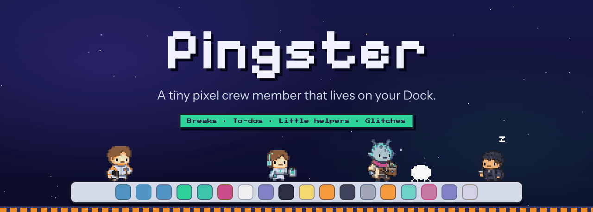
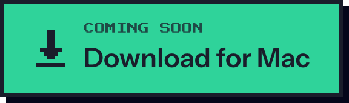
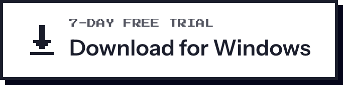
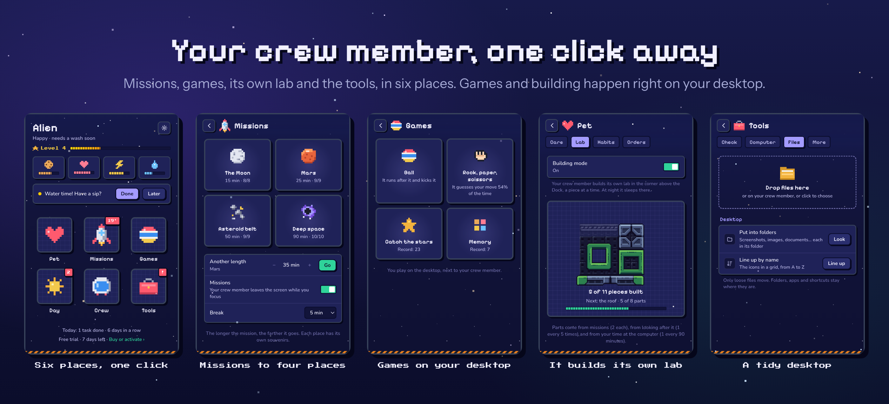
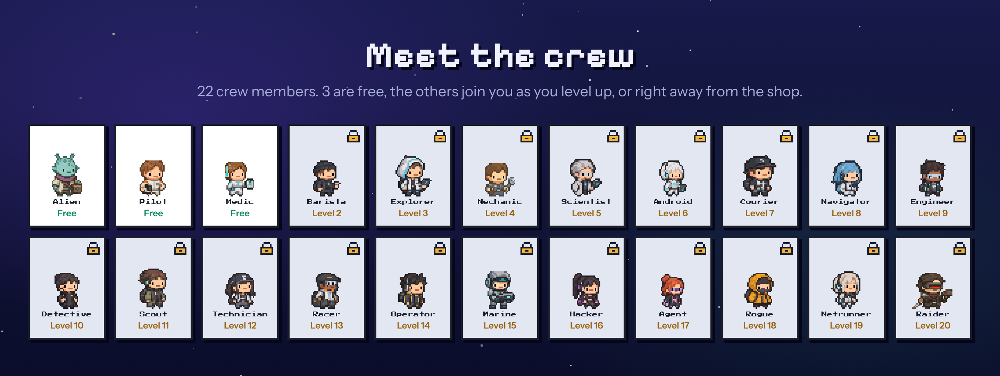

  

  
  &nbsp;
  
  &nbsp;
  

  <b>A tiny pixel crew member that lives on your Dock or taskbar.</b> 
  It reminds you to take breaks, keeps your to-dos and fixes small annoying things. 
  Give it a snack now and then.

  
  
  
  
  

---

## A small app, not a game

Pinglets sits at the bottom of your screen and walks along the Dock (or the taskbar) while you work. Click it, drag it, throw
it, pat it. It is there to help you with the day, and it needs a bit of help from you too.

<table>
  <tr>
    <td align="center" width="33%"> <b>It needs you</b> Food, mood, energy and a wash now and then. Leave it alone too long and it gets sad. It never dies.</td>
    <td align="center" width="33%"> <b>It keeps you on track</b> Skip a break or forget a reminder and a glitch walks in. Do the task and the glitch is gone.</td>
    <td align="center" width="33%"> <b>It rests too</b> Quiet at night, quiet while you focus. It saves its questions for later.</td>
  </tr>
</table>

### Useful tasks

| | |
|---|---|
| **Focus missions** | 25 minutes of focus, a short break, repeat. Meanwhile your crew member goes on a mission and comes back with a souvenir: 32 to collect, something new every time. |
| **Healthy breaks** | Drink water, check your posture, rest your eyes, stand up. You choose how often. |
| **Reminders** | "Call the dentist at 15:00", "Vitamins every day at 9". Once, every day, on weekdays or every week. |
| **To-dos** | With a due time if you like. Late ones turn into glitches. |
| **Today's orders** | Three small things a day, for bonus XP. Missing a day costs nothing. |

### Guard

| | |
|---|---|
| **Check before you trust** | Paste a link, a message or an IBAN. It spots fake banks, couriers and shops, brand-new websites, "Hi mum, this is my new number", gift-card requests and wrong IBANs. Or right-click your crew member: "Check copied text". |
| **Computer check-up** | Backup on or off, free disk space, battery health. Once a week it tells you if something needs a look. |
| **Alerts** | The internet drops (and comes back), a Wi-Fi with no password. During calls it steps aside and stays quiet. |
| **Passwords** | A strong one that is easy to type, and a check whether yours appeared in stolen data, without ever sending it. |

### Files

Drop files on your crew member (or on its window) and only what fits shows up. New files are saved next to the
originals, never over them.

| | |
|---|---|
| **Photos** | Make them smaller for email, HEIC to JPG or PNG, remove where and when they were taken, put them in one PDF, copy the text in a picture. |
| **PDFs** | Join, split into pages, sign with your own signature. |
| **Many files** | Rename them all at once (and undo). |
| **Tidy up** | Old installers and archives in Downloads go to the Trash; find the biggest files. |
| **Clipboard history** | The last 20 texts you copied, in memory only. Off unless you turn it on. |

### Out of your way

| | |
|---|---|
| **Quiet mode** | Silence for an hour or until tomorrow. |
| **Away from the computer?** | It notices, waits, and counts it as a break. |
| **Full screen** | It steps aside for full-screen apps, games and presentations, and can stay out of screen sharing. |
| **Light** | It uses about 3% of one CPU core while it stands on the Dock. |

### Little helpers

| | |
|---|---|
| **Coffee** | Your pet drinks a coffee and the computer stays awake: no sleep, no dark screen. |
| **Clean text** | Copy text, press the button, paste: no fonts, colours, links or odd spaces. |
| **Decide for me** | Pizza, sushi or tacos? It picks. Or it flips a coin. |
| **Rubber duck** | Stuck? Tell it the problem. It asks the questions that help you find the answer. |
| **Countdown** | Days left to the holidays, a deadline, a birthday. It tells you every morning. |

  

  

Each crew member has a character of its own (curious, brave, caring, cheeky…) with its favourite snacks and its own
lines. Bring a friend along and two of them walk on your Dock. Halloween, winter, New Year, Yuri's Night and the
Perseids each bring costumes for the glitches, something over the Dock and a souvenir of their own. English and
Italian.

## Download

| | |
|---|---|
| **Mac** | [Free trial for Mac](https://github.com/mekai-games/pinglets/releases/latest/download/Pinglets.dmg) · macOS 11 or later, Apple silicon or Intel |
| **Windows (beta)** | [Free trial for Windows](https://github.com/mekai-games/pinglets/releases/latest/download/Pinglets-Setup.exe) · Windows 10 or 11, 64-bit |
| **License** | Everything works for 7 days. Then [get your license](https://mekaigames.com/pinglets#buy) for 6,99 €, once. One key, up to 3 computers. |

On a Mac, open the `.dmg` and drag Pinglets into Applications. On Windows, run the setup; if Windows says it protected
your PC, click "More info", then "Run anyway" (the Windows version is new). Pinglets lives in the menu bar or in the tray
next to the clock: no window in your way, and it tells you when a new version is out.
Every version is in [Releases](../../releases).

## Privacy

Your crew member, your tasks and your files stay on your computer. No account, no ads, no tracking: your license key is
checked with Lemon Squeezy, our reseller, and the link and password checks reach the internet only when you use them. Read the [privacy policy](https://mekaigames.com/pinglets/privacy) and the
[terms](https://mekaigames.com/pinglets/terms).

## FAQ

<b>How much is it?</b>

 
6,99 €, one payment, with free updates. Try everything free for 7 days first. All 22 crew members are included:
Alien, Pilot and Medic from day one, the others join you as you level up. One license works on up to 3 computers.

<b>Will it get in my way?</b>

 
No. Clicks go through everything except the crew member itself, and you can hide it at any time: right-click it,
or use the menu bar on a Mac and the tray on Windows.

<b>What happens if I ignore it?</b>

 
It gets hungry, sleepy and a bit sad, and glitches show up for the tasks you skip. It never dies: a snack, a
pat and a done task bring it back.

<b>Found a bug or have an idea?</b>

 
<a href="../../issues/new/choose">Open an issue</a> here, or write to mekai.official.games@gmail.com.

---

  Made by <a href="https://mekaigames.com"><b>MEKAI GAMES</b></a>, an independent studio from Italy. 
  © 2026 MEKAI GAMES. All rights reserved. This repository is the public home of Pinglets: news, releases and bug reports.

